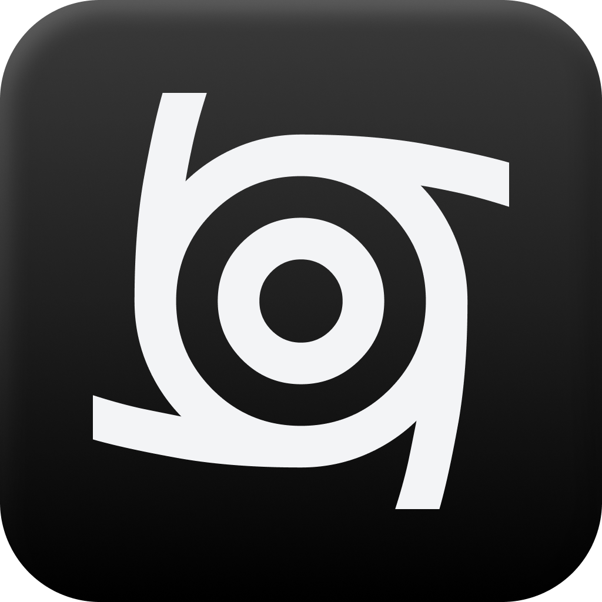
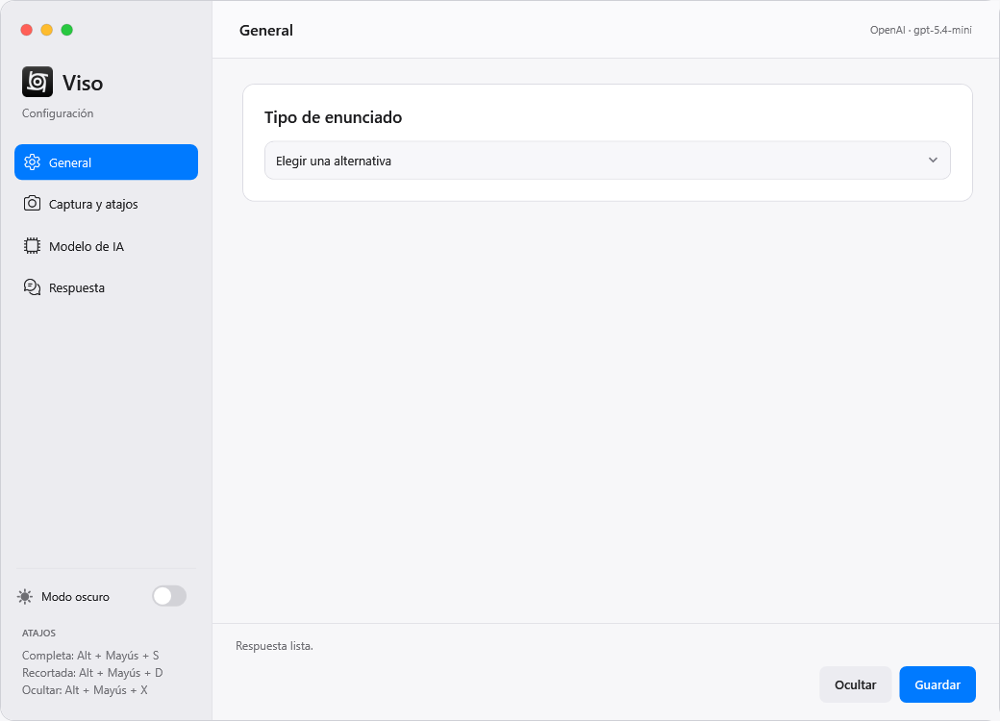
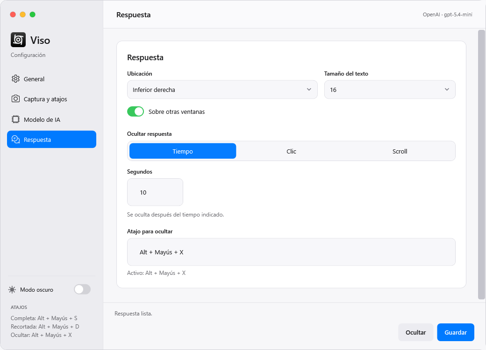

<p align="center">
  
</p>

<h1 align="center">Viso</h1>

<p align="center">Captura un ejercicio. Consulta tu modelo. Recibe la respuesta.</p>

<p align="center">
  <a href="https://github.com/srg-cp/viso/actions/workflows/build.yml"></a>
  <a href="https://github.com/srg-cp/viso/releases/latest"></a>
  
  
  
  
</p>

Viso es una aplicación de escritorio para Windows. Con un atajo captura la pantalla o un área guardada, envía la imagen al modelo que elijas y muestra la respuesta como texto sobre la pantalla.

<picture>
  <source media="(prefers-color-scheme: dark)" srcset="docs/images/viso-dark.png">
  <source media="(prefers-color-scheme: light)" srcset="docs/images/viso-light.png">
  
</picture>

## Funciones

- Dos tipos de ejercicio: elegir una alternativa o completar un enunciado.
- Captura de un monitor completo o de un área que puedes guardar.
- Dos atajos configurables: respuesta completa y respuesta con un límite de caracteres.
- Texto superpuesto en la esquina inferior derecha o izquierda, con tamaño ajustable.
- Vista previa en vivo de la respuesta completa o recortada y color de texto personalizado por RGB o selector de color.
- Ocultamiento por tiempo, clic o scroll, con un atajo independiente para ocultar la respuesta.
- Interfaz con modo claro y oscuro, animaciones y acceso desde la bandeja.
- OpenAI y Gemini, con una clave independiente para cada proveedor.
- Ejecutable portable para Windows de 64 bits, con .NET incluido.

## Primeros pasos

Descarga **Viso.exe** desde el [último Release](https://github.com/srg-cp/viso/releases/latest). No necesita instalación.

1. Abre `Viso.exe`.
2. En **Modelo de IA**, selecciona el proveedor y modelo, introduce tu API key y pulsa **Guardar**.
3. En **General**, elige el tipo de enunciado y cómo se oculta la respuesta.
4. En **Captura y atajos**, configura el monitor, el área y tus combinaciones de teclas.
5. Pulsa **Ocultar** y utiliza un atajo para capturar y enviar la imagen.

| Atajo predeterminado | Qué muestra |
| --- | --- |
| **Alt + Mayús + S** | La respuesta completa |
| **Alt + Mayús + D** | Los primeros N caracteres de la respuesta |
| **Alt + Mayús + X** | Oculta la respuesta |

Los dos atajos de captura envían la imagen en una sola acción. El límite de caracteres incluye espacios y signos y solo afecta al texto mostrado; la consulta al modelo es la misma.

En **Apariencia** tienes la vista previa primero, seguida de la esquina, el tamaño del texto y el selector de color integrado. Haz clic o arrastra sobre el espectro, ajusta el brillo o introduce componentes RGB entre 0 y 255; el resultado cambia al instante. Activa **Predeterminado** para restaurar el blanco. El interruptor de la barra lateral cambia el tema. Pulsa **Guardar** para conservar los ajustes.

En **General** elige cómo ocultar la respuesta:

| Modo | Cuándo desaparece |
| --- | --- |
| **Tiempo** | Después de los segundos que indiques: entre 1 y 3.600, por defecto 10. |
| **Clic** | Al pulsar cualquier botón del mouse en cualquier parte de la pantalla. |
| **Scroll** | Al mover la rueda del mouse, en vertical u horizontal. Los clics no la ocultan. |

El **atajo para ocultar** funciona en los tres modos y se configura junto a los dos atajos de captura en **Captura y atajos**. El mouse conserva su función normal. Al iniciar otra captura se oculta la respuesta anterior; cada respuesta nueva reinicia el tiempo o la detección del mouse.



El menú del icono junto al reloj permite abrir la configuración, capturar, copiar u ocultar la respuesta y salir. El botón rojo cierra Viso.

## Compilar

Necesitas Windows 10 u 11 de 64 bits y el SDK de .NET 8. Desde la raíz del repositorio:

```powershell
.\build.ps1 -Test
```

El resultado queda en `dist/Viso/Viso.exe`. Es un ejecutable autocontenido; el equipo donde lo uses no necesita instalar .NET.

Puedes cambiar la carpeta de salida:

```powershell
.\build.ps1 -OutputDirectory dist/portable
```

Para trabajar con el código, abre `Viso.sln` en Visual Studio o compila la solución con `dotnet build Viso.sln`.

El workflow **Build** compila y ejecuta las pruebas locales en Windows. Si termina correctamente, puedes descargar `Viso-windows-x64` desde la sección **Actions** del repositorio.

## Publicar una versión

El workflow **Release** utiliza la misma compilación y las mismas pruebas que **Build**. Solo publica si las pruebas unitarias y las comprobaciones del ejecutable pasan.

1. Actualiza `<Version>` en `src/Viso/Viso.csproj` y guarda los cambios en un commit.
2. Crea y sube un tag con esa versión:

```powershell
git tag v2.1.0
git push origin v2.1.0
```

El tag debe coincidir con la versión del proyecto. GitHub Actions crea el Release y adjunta **Viso.exe** y **Viso.exe.sha256**, que permite comprobar su integridad. También puedes ejecutar **Release** manualmente desde **Actions**, indicando un tag existente.

Si repites la ejecución para el mismo tag, actualiza esos archivos en el Release existente. No necesitas configurar claves de OpenAI o Gemini ni un token personal para publicar; el workflow usa el token temporal de GitHub.

## Claves y privacidad

Obtén tu clave en [OpenAI](https://platform.openai.com/api-keys) o [Google AI Studio](https://aistudio.google.com/apikey). Necesitas conexión a Internet y acceso al modelo seleccionado. Los límites y el costo dependen de tu cuenta y del proveedor.

| Dato | Cómo se utiliza |
| --- | --- |
| Captura | Se mantiene en memoria durante el uso normal y se envía por HTTPS directamente al proveedor elegido. |
| API key | Se utiliza para autenticar la consulta. Si activas **Recordar claves**, se guarda cifrada con Windows DPAPI para tu usuario. |
| Ajustes | Se guardan en `%LOCALAPPDATA%\Viso\settings.json`, fuera del repositorio. |

Al desactivar **Recordar claves** y guardar, se eliminan las claves persistentes de la configuración de Viso. La aplicación puede leer la configuración de una instalación anterior; los siguientes guardados utilizan la carpeta de Viso. El archivo anterior permanece en su ubicación original.

No hay un servidor intermediario. Las solicitudes a OpenAI incluyen `store: false`; consulta las condiciones de cada proveedor para conocer su retención y uso de datos.

Cada consulta puede tener costo. Viso evita envíos simultáneos y no hace reintentos automáticos. Cancelar la espera no anula una solicitud que el proveedor ya haya recibido.

Las respuestas pueden contener errores; comprueba las soluciones antes de utilizarlas.

## Estructura

```text
assets/branding/             Logo original e icono de Windows
docs/images/                Vistas de la interfaz para este README
src/Viso/
  Capture/                  Capturas, áreas y atajos
  Configuration/            Ajustes y cifrado de claves
  Models/                   Clientes de API, prompts y respuestas
  Presentation/             Temas, bandeja y animaciones
    Windows/                Ventanas y diálogos
  Diagnostics/              Pruebas locales y evaluación de imágenes
.github/workflows/          Compilación automática
tests/Viso.Tests/           Pruebas unitarias con xUnit
Viso.sln                    Solución de Visual Studio
build.ps1                   Generación del ejecutable portable
```

Los ejecutables, la configuración local y los informes de prueba están excluidos de Git. El PNG y el SVG del logo están en `assets/branding`; el archivo `.ico` incluye varios tamaños para Windows.

## Pruebas

Para ejecutar las pruebas unitarias en Windows:

```powershell
dotnet test tests/Viso.Tests/Viso.Tests.csproj -c Release
```

Cubren el recorte de caracteres Unicode, las áreas en varios monitores, las respuestas incompletas o bloqueadas, el ocultamiento de claves en errores y la exclusión del razonamiento interno de la respuesta visible. Usan datos locales, sin llamadas a modelos.

**Build** las ejecuta en cada push a `main` y en cada pull request. **Release** las ejecuta antes de publicar. Los resultados `.trx` y el informe de comprobaciones del ejecutable quedan en el artefacto `Viso-test-results`, incluso si las pruebas fallan.

`build.ps1 -Test` ejecuta pruebas con respuestas simuladas. Comprueba los clientes de API, el cifrado, los atajos, las áreas guardadas, el recorte de texto, los recursos del logo y la compatibilidad de la configuración. No requiere claves ni consume API.

Las pruebas de interfaz necesitan una sesión interactiva de Windows:

```powershell
$p = Start-Process .\dist\Viso\Viso.exe -ArgumentList '--smoke-test' -Wait -PassThru
Get-Content .\dist\Viso\smoke-test-result.txt
$p.ExitCode
```

Comprueban los temas, los controles de ventana, los diálogos, la bandeja, los atajos y la respuesta superpuesta. No modifican tus ajustes. Los informes y capturas de prueba quedan junto al ejecutable.

Para evaluar una imagen con Gemini:

```powershell
.\dist\Viso\Viso.exe --evaluate-image ejercicio.png --expected c --runs 1
```

Este comando usa la clave de Gemini guardada y realiza una consulta real, que puede tener costo. Admite `--crop x,y,ancho,alto` y hasta tres ejecuciones. Guarda `evaluation-result.json`; la respuesta esperada se usa para comprobar el resultado y no se envía al modelo.
